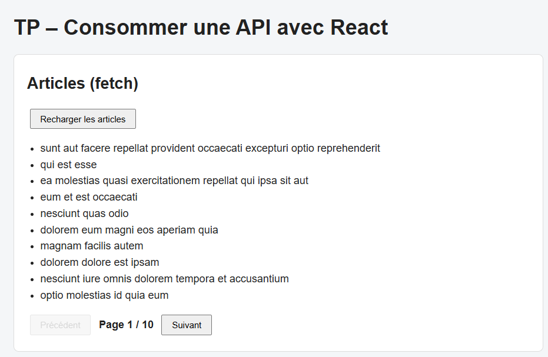
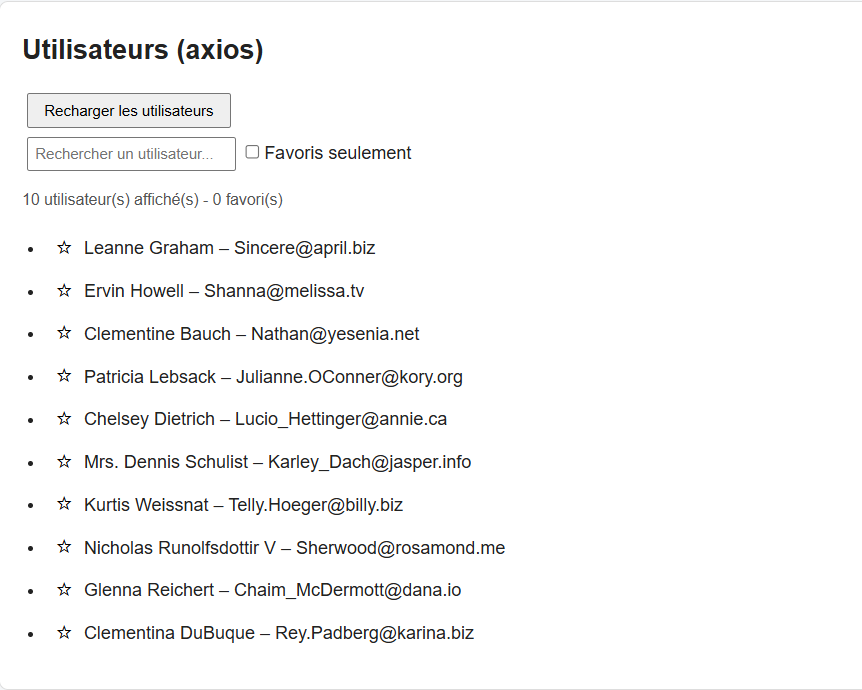
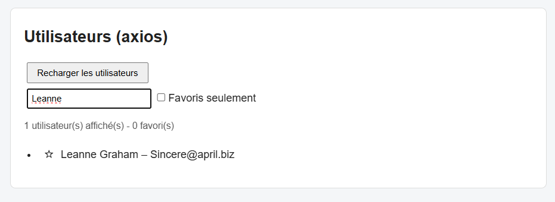
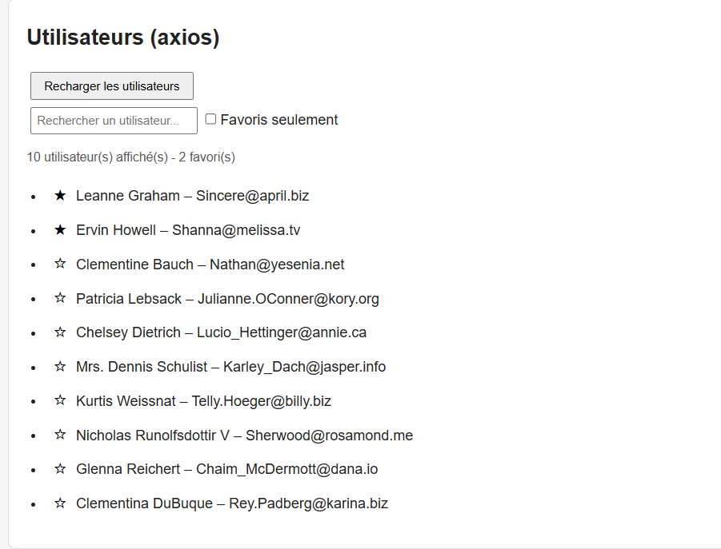

# TP 8 : Consommer une API avec Fetch et Axios dans React

> **Réalisé par :** OUADAY Sara

## Objectifs

- Comprendre les différences entre `fetch` et Axios.
- Récupérer des données dans des composants React.
- Gérer les états `loading`, `error` et les données reçues.
- Factoriser la logique dans un hook réutilisable, `useApi`.

## Structure

```
src/
├── hooks/
│   └── useApi.js
├── App.js
├── App.css
├── FetchPosts.js
├── AxiosUsers.js
├── index.js
└── index.css
```
## FetchPosts : articles avec `fetch`

Le composant affiche un message pendant le chargement, un message en cas d'erreur, puis la liste des articles.



## AxiosUsers : utilisateurs avec Axios

Axios renvoie directement les données dans `response.data`, sans appeler `.json()`.



## Gestion des erreurs

Avec `fetch`, il faut tester `res.ok` soi-même. Avec Axios, un statut 400 ou plus rejette la promesse automatiquement, et `error.response.status` donne le code.

## Bouton de rechargement

Le bouton est désactivé pendant le chargement pour éviter les doubles appels.



## Hook personnalisé `useApi`

Le hook factorise `data`, `loading`, `error` et `reload`, et fonctionne avec `fetch` ou Axios selon l'option `client`.

## Exercices avancés

### Pagination

Les articles sont chargés par page avec `?_page=1&_limit=10`.


## Ma partie personnelle

Un système de **favoris** : une étoile sur chaque utilisateur, un compteur de favoris, et une case pour n'afficher que les favoris. Les favoris sont sauvegardés dans le `localStorage`.




## Conclusion

- `fetch` est natif mais demande de vérifier `res.ok` et d'appeler `.json()`.
- Axios simplifie les requêtes : données dans `response.data` et erreurs HTTP gérées automatiquement.
- Un hook personnalisé évite de répéter la même logique dans chaque composant.
- Il faut toujours gérer les trois états : chargement, erreur et données.
